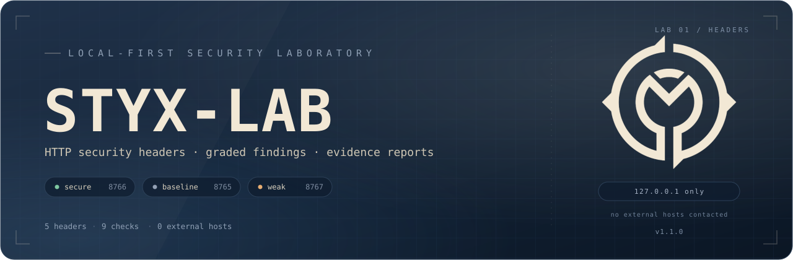
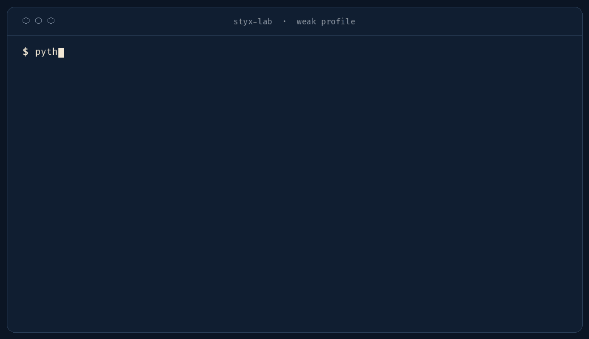
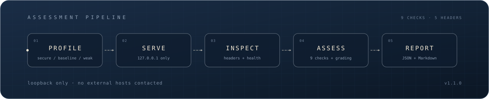

<div align="center">
  
</div>

<div align="center">

**English** &nbsp;·&nbsp; [Türkçe](README_TR.md)

[](https://github.com/raxwqx/STYX-LAB/actions/workflows/tests.yml)
[](https://github.com/raxwqx/STYX-LAB/releases)
[](pyproject.toml)
[](LICENSE)

</div>

---

> A security headers lab that never leaves your machine.
>
> ◆ &nbsp;Three profiles on one loopback server.
> ◆ &nbsp;Presence checks plus graded findings.
> ◆ &nbsp;JSON and Markdown evidence you can archive.

<div align="center">
  
</div>

<div align="center"><sub>The GIF is not a mock-up. It is rendered from the CLI's own output by <code>tools/make_assets.py</code>.</sub></div>

---

## What it is

STYX-LAB is a local HTTP security headers laboratory. It serves the same small
page under three profiles — `secure`, `baseline`, and `weak` — so you can
inspect the real response, run nine local checks, grade the header values, and
write the result to JSON and Markdown.

Nothing is scanned, resolved, or sent beyond `127.0.0.1`. There are no
containers, no external targets, and no runtime dependencies.

<div align="center">
  
</div>

<div align="center"><sub>Every stage is a local step. The rule at the bottom is the part that makes the output safe to publish.</sub></div>

<div align="center">
  
</div>

## Profiles

| Profile | Default port | Behaviour |
|:--|:--:|:--|
| `secure` | `8766` | Sends the configured training security headers |
| `baseline` | `8765` | Omits the five training headers |
| `weak` | `8767` | Sends all five headers with deliberately unsafe values |

All three send `Cache-Control: no-store`. `baseline` and `weak` are comparison
profiles, not deployment templates.

The `weak` profile is the useful one for practice: every header is present, so a
presence-only check looks clean, while the grader shows why the values are
dangerous. That difference is the point of the lab.

### The five headers

| Header | `secure` value | `weak` value |
|:--|:--|:--|
| `Content-Security-Policy` | `default-src 'self'; object-src 'none'; base-uri 'self'; frame-ancestors 'none'` | `default-src * 'unsafe-inline' 'unsafe-eval'; object-src *` |
| `X-Content-Type-Options` | `nosniff` | `sniff` |
| `Referrer-Policy` | `strict-origin-when-cross-origin` | `unsafe-url` |
| `Permissions-Policy` | `camera=(), microphone=(), geolocation=()` | `camera=*, microphone=*, geolocation=*` |
| `X-Frame-Options` | `DENY` | `ALLOWALL` |

---

## Quick start

Python 3.11 or newer. No third-party runtime packages; `curl` is optional.

```console
$ git clone https://github.com/raxwqx/STYX-LAB.git
$ cd STYX-LAB
$ python3 lab/web/security_headers_lab.py --profile secure --port 8766
STYX-LAB 1.1.0 | profile=secure
STYHQ local node: http://127.0.0.1:8766/
Press Ctrl+C to stop.
```

In a second terminal, read the headers the server actually sends:

```console
$ curl -sI 127.0.0.1:8766 | grep -E 'HTTP|Server|Content-Security|X-Frame|Referrer'
HTTP/1.0 200 OK
Server: STYX-LAB/1.1.0
Content-Security-Policy: default-src 'self'; object-src 'none'; base-uri 'self'; frame-ancestors 'none'
Referrer-Policy: strict-origin-when-cross-origin
X-Frame-Options: DENY
```

Then assess the running profile:

```console
$ python3 -m lab.report --port 8766
Assessment result: PASS
Header findings: 0
Fail-on: none
JSON report: reports/latest-assessment.json
Markdown report: reports/latest-assessment.md
```

### Practise detection on the weak profile

```console
$ python3 lab/web/security_headers_lab.py --profile weak --port 8767
STYX-LAB 1.1.0 | profile=weak
STYHQ local node: http://127.0.0.1:8767/
Press Ctrl+C to stop.
```

```console
$ curl -sI 127.0.0.1:8767 | grep -E 'HTTP|Server|Content-Security|X-Frame|Referrer'
HTTP/1.0 200 OK
Server: STYX-LAB/1.1.0
Content-Security-Policy: default-src * 'unsafe-inline' 'unsafe-eval'; object-src *
Referrer-Policy: unsafe-url
X-Frame-Options: ALLOWALL
```

```console
$ python3 -m lab.report --port 8767 --fail-on medium
error: --fail-on medium: findings at or above 'medium' severity were detected
Assessment result: PASS
Header findings: 8
Fail-on: medium
JSON report: reports/latest-assessment.json
Markdown report: reports/latest-assessment.md
$ echo $?
1
```

The report is still written when the threshold trips, so the evidence survives
the failed gate.

### Control deck

Prefer a menu? Run `python3 lab/tui.py` from the repository root.

| Key | Action |
|:--:|:--|
| `1` | Launch secure profile |
| `2` | Launch baseline profile |
| `3` | Launch weak profile |
| `4` | Run the test suite |
| `5` | Run a local assessment |
| `6` | Read the scenario guide |
| `0` | Exit |

`STYXLAB_NO_ANIMATION=1` and `NO_COLOR=1` are supported. The startup lock
animation is branding, not access control.

---

## Graded findings

Presence is not quality. The exact-match checks ask whether the lab behaved as
declared; the grader asks whether the declared values are safe. A real run
against the `weak` profile produces:

| Severity | Header | Finding |
|:--|:--|:--|
| **HIGH** | `Content-Security-Policy` | CSP allows every source (`*`) in `default-src`, `object-src` |
| **MEDIUM** | `X-Frame-Options` | X-Frame-Options has an invalid value: `ALLOWALL` |
| **MEDIUM** | `Referrer-Policy` | Referrer-Policy uses `unsafe-url` and leaks full URLs |
| **LOW** | `X-Content-Type-Options` | X-Content-Type-Options is `sniff`, not `nosniff` |

Eight findings in total: **1 HIGH, 5 MEDIUM, 2 LOW**. The `secure` profile
produces none.

| Status | Meaning |
|:--|:--|
| `PASS` | The lab matched its declared profile |
| `FAIL` | One or more checks did not match |
| `UNAVAILABLE` | The local response could not be obtained or parsed |

A `PASS` is not a security audit. The weak profile passes all nine checks and
still produces eight findings — that gap is the lesson.

### The `--fail-on` gate

By default findings do not change the exit status. For CI or scripts, set a
threshold:

| Value | Effect |
|:--|:--|
| `none` | Never fail because of findings (default) |
| `low` | Fail on LOW or worse |
| `medium` | Fail on MEDIUM or worse |
| `high` | Fail on HIGH or worse |
| `critical` | Fail on CRITICAL only |

---

## Reports

```text
reports/
├── latest-assessment.json
└── latest-assessment.md
```

The JSON report records the tool version, target, profile, scope, every check
with its evidence, the finding summary, and each finding with a remediation
hint. The Markdown report is the same evidence as a reviewable table.

```console
$ python3 -m lab.report --port 8766 --output-dir reports/demo --timeout 5
```

`--timeout` applies to each local request (default `2` seconds, maximum `30`).
Review reports before publishing them; they contain environment details.

---

## Endpoints

| Endpoint | Method | Purpose |
|:--|:--:|:--|
| `/` | GET | Training homepage |
| `/health` | GET | JSON service status |
| `/api/headers` | GET | Active profile and header metadata |
| unknown path | GET | JSON 404 response |

The service binds to `127.0.0.1` only.

---

## Testing

```console
$ python3 -m unittest discover -s tests -v   # 51 tests
$ python3 -m compileall -q lab tests
```

GitHub Actions runs both commands on Python 3.11, 3.12, and 3.13.

Regenerate the artwork with `python3 tools/make_assets.py` (needs Pillow and
ffmpeg). The script starts the real lab, captures the real output, and stops it
again.

---

## Layout

```text
STYX-LAB/
├── lab/
│   ├── headers.py                  checks, grading, summaries
│   ├── report.py                   JSON + Markdown evidence
│   ├── tui.py                      terminal control deck
│   └── web/security_headers_lab.py local HTTP server and profiles
├── tests/                          51 unit and integration tests
├── tools/make_assets.py            hero, pipeline, GIF and MP4 from real output
├── assets/                         hero, pipeline, demo, logo
├── docs/                           architecture, methodology, scenarios
├── .github/workflows/tests.yml     Python 3.11–3.13 CI
├── CHANGELOG.md
├── CONTRIBUTING.md
├── ROADMAP.md
└── SECURITY.md
```

---

## Scope and responsible use

STYX-LAB is a defensive, educational project. The current implementation:

- serves a local HTTP service bound to `127.0.0.1`;
- assesses only that local service;
- does not scan external hosts or resolve remote hostnames;
- is not a general-purpose vulnerability scanner;
- is not intended for public production deployment.

Use security tools only on systems you own or have explicit permission to
assess. See [SECURITY.md](SECURITY.md).

## Roadmap

The current release is the HTTP security headers lab. The longer-term goal is a
modular platform for OSINT workflows, digital forensics, and isolated defensive
exercises, added gradually and documented as each one becomes real. See
[ROADMAP.md](ROADMAP.md); future ideas are not current features.

## Contributing

Read [CONTRIBUTING.md](CONTRIBUTING.md), keep experiments local and
reproducible, add tests for new behaviour, and never commit credentials or
private data.

## License

MIT. See [LICENSE](LICENSE).

---

<p align="center">
  <strong>STYX-LAB</strong><br>
  <sub>Research responsibly. Investigate carefully. Build openly.</sub><br><br>
  <a href="https://github.com/raxwqx/STYX-LAB">GitHub Repository</a> ·
  <a href="https://github.com/raxwqx">Developer Profile</a>
</p>
