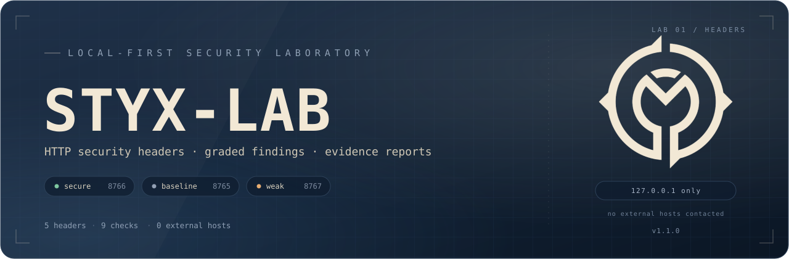
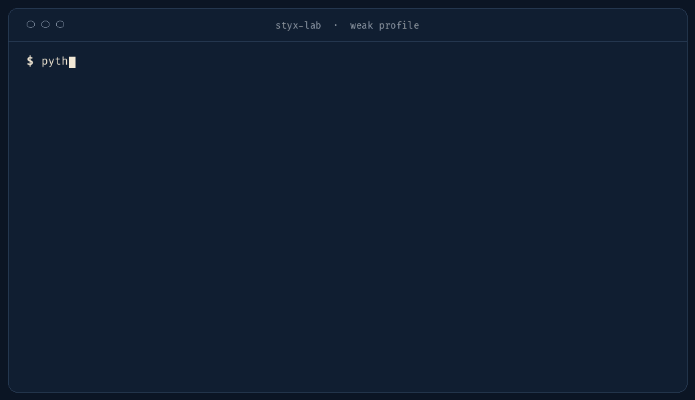
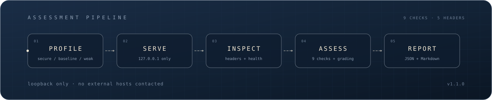

<div align="center">
  
</div>

<div align="center">

[English](README.md) &nbsp;·&nbsp; **Türkçe**

[](https://github.com/raxwqx/STYX-LAB/actions/workflows/tests.yml)
[](https://github.com/raxwqx/STYX-LAB/releases)
[](pyproject.toml)
[](LICENSE)

</div>

---

> Makinenizden çıkmayan bir güvenlik başlıkları laboratuvarı.
>
> ◆ &nbsp;Tek loopback sunucusunda üç profil.
> ◆ &nbsp;Varlık kontrolü artı dereceli bulgular.
> ◆ &nbsp;Arşivleyebileceğiniz JSON ve Markdown kanıtları.

<div align="center">
  
</div>

<div align="center"><sub>GIF bir mock-up değil. CLI'nın kendi çıktısından <code>tools/make_assets.py</code> ile üretildi.</sub></div>

---

## Nedir?

STYX-LAB, yerel çalışan bir HTTP güvenlik başlıkları laboratuvarıdır. Aynı küçük
sayfayı üç profilde sunar — `secure`, `baseline` ve `weak` — böylece gerçek yanıtı
inceleyebilir, dokuz yerel kontrol çalıştırabilir, başlık değerlerini
derecelendirebilir ve sonucu JSON ile Markdown olarak yazabilirsiniz.

`127.0.0.1` dışına hiçbir şey taranmaz, çözümlenmez veya gönderilmez. Container
yok, dış hedef yok, çalışma zamanı bağımlılığı yok.

<div align="center">
  
</div>

<div align="center"><sub>Her aşama yerel bir adım. Alttaki kural, çıktıyı yayınlanabilir kılan kısım.</sub></div>

<div align="center">
  
</div>

## Profiller

| Profil | Varsayılan port | Davranış |
|:--|:--:|:--|
| `secure` | `8766` | Tanımlı eğitim güvenlik başlıklarını gönderir |
| `baseline` | `8765` | Beş eğitim başlığını göndermez |
| `weak` | `8767` | Beş başlığı da bilerek güvensiz değerlerle gönderir |

Üçü de `Cache-Control: no-store` gönderir. `baseline` ve `weak` karşılaştırma
profilleridir; dağıtım şablonu değildir.

Alıştırma için asıl faydalı olan `weak`: her başlık mevcut olduğu için yalnızca
varlığa bakan bir kontrol temiz görünür, derecelendirici ise değerlerin neden
tehlikeli olduğunu gösterir. Laboratuvarın anlatmak istediği fark budur.

### Beş başlık

| Başlık | `secure` değeri | `weak` değeri |
|:--|:--|:--|
| `Content-Security-Policy` | `default-src 'self'; object-src 'none'; base-uri 'self'; frame-ancestors 'none'` | `default-src * 'unsafe-inline' 'unsafe-eval'; object-src *` |
| `X-Content-Type-Options` | `nosniff` | `sniff` |
| `Referrer-Policy` | `strict-origin-when-cross-origin` | `unsafe-url` |
| `Permissions-Policy` | `camera=(), microphone=(), geolocation=()` | `camera=*, microphone=*, geolocation=*` |
| `X-Frame-Options` | `DENY` | `ALLOWALL` |

---

## Hızlı başlangıç

Python 3.11 veya üstü. Üçüncü taraf çalışma zamanı paketi yok; `curl` isteğe
bağlı.

```console
$ git clone https://github.com/raxwqx/STYX-LAB.git
$ cd STYX-LAB
$ python3 lab/web/security_headers_lab.py --profile secure --port 8766
STYX-LAB 1.1.0 | profile=secure
STYHQ local node: http://127.0.0.1:8766/
Press Ctrl+C to stop.
```

İkinci bir terminalde sunucunun gerçekten gönderdiği başlıkları okuyun:

```console
$ curl -sI 127.0.0.1:8766 | grep -E 'HTTP|Server|Content-Security|X-Frame|Referrer'
HTTP/1.0 200 OK
Server: STYX-LAB/1.1.0
Content-Security-Policy: default-src 'self'; object-src 'none'; base-uri 'self'; frame-ancestors 'none'
Referrer-Policy: strict-origin-when-cross-origin
X-Frame-Options: DENY
```

Ardından çalışan profili değerlendirin:

```console
$ python3 -m lab.report --port 8766
Assessment result: PASS
Header findings: 0
Fail-on: none
JSON report: reports/latest-assessment.json
Markdown report: reports/latest-assessment.md
```

### `weak` profili üzerinde tespit alıştırması

```console
$ python3 lab/web/security_headers_lab.py --profile weak --port 8767
STYX-LAB 1.1.0 | profile=weak
STYHQ local node: http://127.0.0.1:8767/
Press Ctrl+C to stop.
```

```console
$ curl -sI 127.0.0.1:8767 | grep -E 'HTTP|Server|Content-Security|X-Frame|Referrer'
HTTP/1.0 200 OK
Server: STYX-LAB/1.1.0
Content-Security-Policy: default-src * 'unsafe-inline' 'unsafe-eval'; object-src *
Referrer-Policy: unsafe-url
X-Frame-Options: ALLOWALL
```

```console
$ python3 -m lab.report --port 8767 --fail-on medium
error: --fail-on medium: findings at or above 'medium' severity were detected
Assessment result: PASS
Header findings: 8
Fail-on: medium
JSON report: reports/latest-assessment.json
Markdown report: reports/latest-assessment.md
$ echo $?
1
```

Eşik tetiklendiğinde rapor yine de yazılır; böylece kanıt, başarısız kapıya
rağmen korunur.

### Kontrol paneli

Menü tercih ederseniz depo kökünde `python3 lab/tui.py` çalıştırın.

| Tuş | Eylem |
|:--:|:--|
| `1` | `secure` profilini başlat |
| `2` | `baseline` profilini başlat |
| `3` | `weak` profilini başlat |
| `4` | Test paketini çalıştır |
| `5` | Yerel değerlendirme çalıştır |
| `6` | Senaryo rehberini oku |
| `0` | Çık |

`STYXLAB_NO_ANIMATION=1` ve `NO_COLOR=1` desteklenir. Açılıştaki kilit
animasyonu marka görselidir; kimlik doğrulama veya erişim kontrolü değildir.

---

## Dereceli bulgular

Başlığın var olması, doğru olduğu anlamına gelmez. Tam eşleşme kontrolleri
laboratuvarın tanımlı profil gibi davranıp davranmadığını sorar; derecelendirici
ise tanımlı değerlerin güvenli olup olmadığını. `weak` profiline karşı gerçek bir
koşunun ürettiği bulgular:

| Önem | Başlık | Bulgu |
|:--|:--|:--|
| **HIGH** | `Content-Security-Policy` | CSP, `default-src` ve `object-src` içinde her kaynağa (`*`) izin veriyor |
| **MEDIUM** | `X-Frame-Options` | X-Frame-Options geçersiz bir değer taşıyor: `ALLOWALL` |
| **MEDIUM** | `Referrer-Policy` | Referrer-Policy `unsafe-url` kullanıyor ve tam URL'leri sızdırıyor |
| **LOW** | `X-Content-Type-Options` | X-Content-Type-Options `nosniff` değil, `sniff` |

Toplam sekiz bulgu: **1 HIGH, 5 MEDIUM, 2 LOW**. `secure` profili hiç bulgu
üretmez.

| Durum | Anlamı |
|:--|:--|
| `PASS` | Laboratuvar tanımlı profiliyle eşleşti |
| `FAIL` | Bir veya daha fazla kontrol eşleşmedi |
| `UNAVAILABLE` | Yerel yanıt alınamadı veya ayrıştırılamadı |

`PASS` bir güvenlik denetimi değildir. `weak` profili dokuz kontrolün hepsinden
geçer ve yine de sekiz bulgu üretir — ders bu farktadır.

### `--fail-on` eşiği

Bulgular varsayılan olarak çıkış kodunu değiştirmez. CI veya betikler için eşik
belirleyin:

| Değer | Etki |
|:--|:--|
| `none` | Bulgu yüzünden asla başarısız olma (varsayılan) |
| `low` | LOW ve üstünde başarısız ol |
| `medium` | MEDIUM ve üstünde başarısız ol |
| `high` | HIGH ve üstünde başarısız ol |
| `critical` | Yalnızca CRITICAL için başarısız ol |

---

## Raporlar

```text
reports/
├── latest-assessment.json
└── latest-assessment.md
```

JSON raporu araç sürümünü, hedefi, profili, kapsamı, kanıtıyla birlikte her
kontrolü, bulgu özetini ve düzeltme ipucuyla birlikte her bulguyu kaydeder.
Markdown raporu aynı kanıtı incelenebilir bir tablo olarak sunar.

```console
$ python3 -m lab.report --port 8766 --output-dir reports/demo --timeout 5
```

`--timeout` her yerel istek için geçerlidir (varsayılan `2` saniye, en fazla
`30`). Raporları yayınlamadan önce gözden geçirin; ortam bilgisi içerirler.

---

## Uç noktalar

| Uç nokta | Yöntem | Amaç |
|:--|:--:|:--|
| `/` | GET | Eğitim ana sayfası |
| `/health` | GET | JSON servis durumu |
| `/api/headers` | GET | Etkin profil ve başlık üst verisi |
| bilinmeyen yol | GET | JSON 404 yanıtı |

Servis yalnızca `127.0.0.1` üzerine bağlanır.

---

## Testler

```console
$ python3 -m unittest discover -s tests -v   # 51 test
$ python3 -m compileall -q lab tests
```

GitHub Actions iki komutu da Python 3.11, 3.12 ve 3.13 üzerinde çalıştırır.

Görselleri `python3 tools/make_assets.py` ile yeniden üretin (Pillow ve ffmpeg
gerekir). Betik gerçek laboratuvarı başlatır, gerçek çıktıyı yakalar ve durdurur.

---

## Dizin yapısı

```text
STYX-LAB/
├── lab/
│   ├── headers.py                  kontroller, derecelendirme, özetler
│   ├── report.py                   JSON + Markdown kanıtı
│   ├── tui.py                      terminal kontrol paneli
│   └── web/security_headers_lab.py yerel HTTP sunucusu ve profiller
├── tests/                          51 birim ve entegrasyon testi
├── tools/make_assets.py            gerçek çıktıdan hero, pipeline, GIF ve MP4
├── assets/                         hero, pipeline, demo, logo
├── docs/                           mimari, metodoloji, senaryolar
├── .github/workflows/tests.yml     Python 3.11–3.13 CI
├── CHANGELOG.md
├── CONTRIBUTING.md
├── ROADMAP.md
└── SECURITY.md
```

---

## Kapsam ve sorumlu kullanım

STYX-LAB savunma odaklı, eğitim amaçlı bir projedir. Mevcut uygulama:

- `127.0.0.1` üzerine bağlı yerel bir HTTP servisi sunar;
- yalnızca bu yerel servisi değerlendirir;
- dış hedefleri taramaz veya uzak ana bilgisayar adlarını çözmez;
- genel amaçlı bir güvenlik açığı tarayıcısı değildir;
- herkese açık üretim dağıtımı için tasarlanmamıştır.

Güvenlik araçlarını yalnızca sahibi olduğunuz veya açık izin aldığınız
sistemlerde kullanın. Bkz. [SECURITY.md](SECURITY.md).

## Yol haritası

Mevcut sürüm HTTP güvenlik başlıkları laboratuvarıdır. Uzun vadeli hedef; OSINT
iş akışları, dijital adli bilişim ve izole savunma alıştırmaları için modüler bir
platform oluşturmak. Her yetenek kademeli olarak, gerçek olduğunda belgelenerek
eklenir. Bkz. [ROADMAP.md](ROADMAP.md); gelecek fikirleri mevcut özellik
değildir.

## Katkı

[CONTRIBUTING.md](CONTRIBUTING.md) dosyasını okuyun, deneyleri yerel ve
tekrarlanabilir tutun, yeni davranış için test ekleyin ve kimlik bilgilerini ya
da özel verileri asla commit etmeyin.

## Lisans

MIT. Bkz. [LICENSE](LICENSE).

---

<p align="center">
  <strong>STYX-LAB</strong><br>
  <sub>Sorumlu araştır. Dikkatle incele. Açıkça geliştir.</sub><br><br>
  <a href="https://github.com/raxwqx/STYX-LAB">GitHub Deposu</a> ·
  <a href="https://github.com/raxwqx">Geliştirici Profili</a>
</p>
